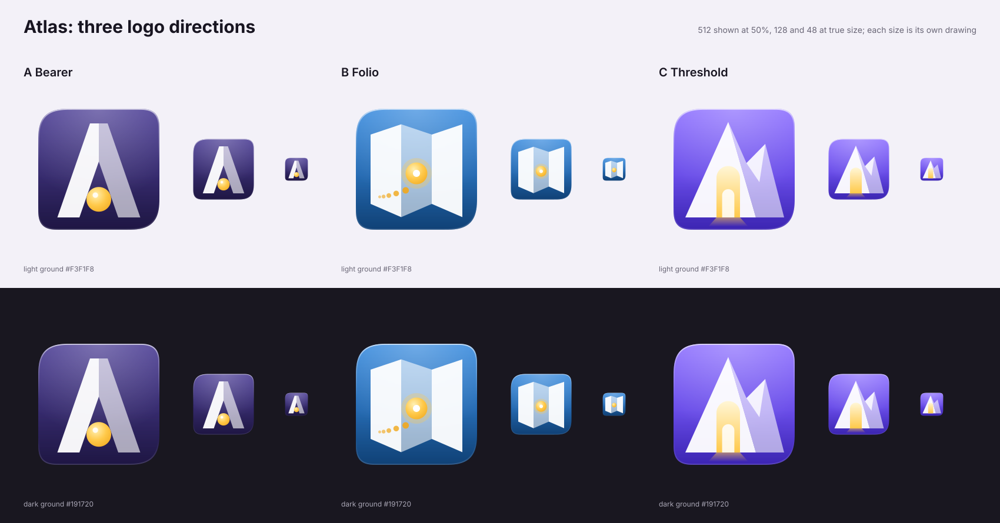

# Atlas: three logo directions

`contact-sheet.png`: the three directions across, on the light ground `#F3F1F8` (top) and the dark ground `#191720` (bottom). The 512 drawing is shown at half size; the 128 and 48 drawings at their size. Each size is its own drawing: 128 drops the fine details, 48 keeps the silhouette, the light/dark split and the gold pop (icons/LANGUAGE.md section 8).

All three are flat single-glyph badges in the family of the Cryswol gem: one white glyph in facet tones of white at 95 percent for the lit face and 58 to 62 percent for the shaded one, one gold pop, on the WolOS soft card with its lit rim. They are generated by `tools/brand/atlas.py`, fill-only: no stroke, no filter, no clip-path, no text, so QtSvg, GTK and `rsvg-convert` draw them alike. The card is the 824 unit soft card of the icon language (`svgk.CARD`), the card ramps are built on the token hues (ink `#221B36`, web `#1D64B0`, accent `#6A4DF4`/`#7C5CFF`/`#8B6CFF`) and the pop is the token gold `#FFC94A`.

Files: `atlas-<key>-<name>-<size>.svg`, with `a-bearer`, `b-folio`, `c-threshold` and sizes 512, 128, 48.

## A. Bearer

The letter A is the name, and it is also a figure carrying a load: two legs under a gold sphere that rests where the crossbar would be, touching both legs. That is the myth in one picture, and it subverts the planet cliché: the world here is a single plain sphere that something else holds up, with no ring, no grid and no swoosh. The card is the deep ink-indigo of the `dev` category lifted to a ramp (`#4D3F96` to `#241B4E`), a colour no browser wears, with the WolOS gold as the world. It is the quietest of the three and reads best as a letter at 48 px. The risk: a letter plus a dot is easy to draw and easy to forget, and the dark card needs its lit rim to stay visible on the dark ground (it does: edge 3.1:1 at 48 px). At 16 px the symbolic follow-up is the A with a round counter.

## B. Folio

A map folded in three, seen as a Z-fold, with a gold "you are here" mark on the middle panel and, at 512 only, a short dotted route towards it. It is the oldest meaning of the word: a book of maps. The three panels take the 95, 58 and 95 percent tones the gem uses for its three faces, so the family likeness is in the light, not in the shape. The card is the `web` category blue (`#3C8DDF` to `#14508F`), which makes it the most literal and the friendliest. The risk is the same: it is the one that can be taken for a Maps app instead of a browser, and a map says "find a place" more than "reach anything". At 16 px the follow-up is the outline of the fold (three panels) with the mark as a dot.

## C. Threshold

The Atlas mountains, two peaks with the ridge splitting a lit face from a shaded one, and the WolOS door standing open in their foot with gold light coming out and an inner door behind it (the nested doors of the WolOS mark, in the mark's own door proportions). The sky-bearing mountains are the myth, the door is the OS: Atlas is the way to the door. It is the only direction that is unmistakably WolOS and only WolOS: the card is the accent violet ramp (`#8F72FF` to `#4B2FD6`) of the system. The risk: next to the system's own violet icons it is less distinct, and without the second peak it would read as a tent; the lesser peak and the ridge are what stop that. At 16 px the follow-up is the peak with the arch cut out of it, one `currentColor` path.

## Recommendation

C. It is the one that carries both the name and the system: the mountain is the myth, the door is the WolOS mark, the gold is the light that comes through. It reads at 48 px (median glyph contrast 3.9:1 against the card), should keep its silhouette at 16 px as one `currentColor` path (not drawn yet), and the mocks in `../chrome/` wear it. A is the safer runner-up and the better pick if the lead wants Atlas to stand apart from the violet of the rest of the system. B is the one to drop.

## Measured (tools/brand/atlas_check.py)

Glyph span of the card width, median contrast of the glyph pixels against the card under them at that size, and the 75th percentile of the edge ring against each ground. The bars are 0.45 to 0.86, 1.35:1 at 48 px, 1.3:1.

| | size | span | median | edge, light | edge, dark |
|---|---|---|---|---|---|
| A | 512 / 128 / 48 | 0.78 / 0.78 / 0.82 | 6.7 / 6.6 / 6.4 | 10.0 / 11.4 / 13.7 | 8.5 / 6.1 / 3.2 |
| B | 512 / 128 / 48 | 0.77 / 0.77 / 0.79 | 3.7 / 3.7 / 3.7 | 5.8 / 6.8 / 7.8 | 10.9 / 9.0 / 6.1 |
| C | 512 / 128 / 48 | 0.83 / 0.83 / 0.82 | 4.0 / 4.0 / 3.9 | 6.0 / 6.8 / 7.8 | 10.9 / 9.0 / 6.1 |

Not measured: the 16 px symbolic follow-ups (not drawn), QtSvg (no Qt harness on this branch), a print or one-colour version, a wordmark.
